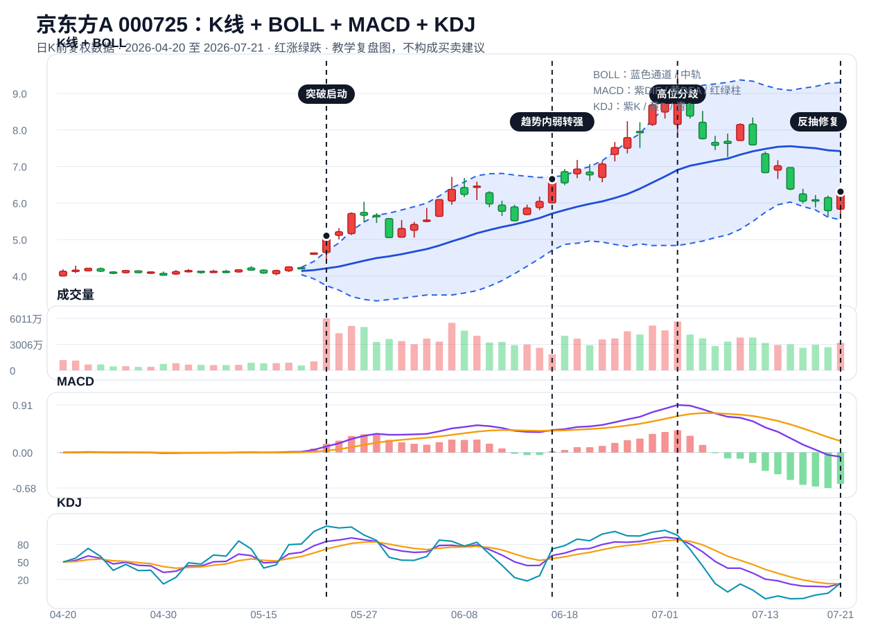

# 交易知识体系手册

> 版本日期：2026-07-22  
> 定位：这不是指标大全，也不是聊天记录归档，而是一套用于选股、买入、卖出、风控和复盘的执行框架。  
> 提醒：本文只用于学习和复盘，不构成投资建议。任何指标、新闻、异动、K线形态都不能单独等同于买点。

## 1. 总纲

最核心的一句话：

```text
先看环境，再看板块，再看个股。
先看结构，再看量能，再看买点。
先想错了在哪里卖，再想能赚多少。
```

我们最后确定的交易框架是：

```text
三闸门不开，六灯再亮也不买。
三闸门开了，再用六灯筛买点。
```

三闸门是“能不能买”的前置条件：

```text
1. 大盘环境允许交易。
2. 板块相对市场强。
3. 个股相对板块和大盘强。
```

六灯是“买点质量”的确认：

```text
主线灯：是不是市场资金认可的方向。
环境灯：市场有没有系统性风险。
结构灯：趋势和位置是否健康。
量能灯：突破、回踩、修复是否有量能配合。
资金灯：是否有板块共振，不是单票一日游。
风控灯：止损位置、盈亏比、仓位是否舒服。
```

这一套的目标不是保证买了就涨，而是让每一笔交易都做到：

```text
知道为什么买。
知道什么条件才买。
知道错了在哪里卖。
知道最多亏多少。
```

## 2. 买前必须先过三闸门

### 2.1 大盘环境

大盘不是简单看红绿，而是看市场有没有交易条件。

重点看：

- 指数是否在10日线、20日线附近保持健康。
- 成交额是否放大。
- 涨跌家数是否极端恶化。
- 是否有明确主线板块。
- 强势票是否有赚钱效应。

大盘绿不一定坏。如果大盘弱，个股和板块反而红盘、抗跌、放量，就说明相对强。  
大盘红也不一定好。如果个股不涨、板块不跟、冲高回落，那就是弱。

### 2.2 板块强度

板块比单票重要。

一个方向能不能看，要看：

- 不是只有一只票涨，而是多只核心票共振。
- 中军是否稳。
- 龙头是否有高度。
- 后排是否跟随，但不能过度杂乱。
- 资金是持续流入，还是一天游。

主线不是固定的。科技强就看科技，资金轮动到有色、医药、消费，也要能识别轮动。  
但识别轮动不等于乱买，仍然要回到三闸门和买点质量。

### 2.3 个股相对强弱

相对强弱是筛选核心票的关键。

比较顺序：

```text
个股 vs 大盘
个股 vs 板块
个股 vs 同方向核心票
```

实战判断：

- 大盘跌，个股红，说明当天强。
- 板块分歧，个股抗跌，说明个股相对强。
- 大盘涨，板块涨，个股不涨，说明弱。
- 一天强不够，阶段持续强才更重要。

记住：

```text
阶段强 > 当天强。
板块强 > 单票强。
连续强 > 一天强。
```

## 3. 技术分析只保留五个核心

技术分析不要学成一堆名字。真正有用的只有五个核心：

```text
趋势结构。
位置阶段。
量价承接。
支撑压力。
突破、回踩、弱转强。
```

### 3.1 趋势结构

趋势结构看三个问题：

```text
高点是不是抬高？
低点是不是抬高？
股价是不是在关键均线或布林中轨上方？
```

上升趋势：

- 高点抬高。
- 低点抬高。
- 回踩后能修复。
- 跌下来有人接。

下降趋势：

- 高点降低。
- 低点降低。
- 反弹不过前高。
- 每次冲高都被砸。

这里有一个很重要的区分：

```text
上升趋势里的下跌，可能是回踩。
下降趋势里的上涨，可能只是反抽。
```

### 3.2 位置阶段

同样一根大阳线，位置不同，意义完全不同。

```text
低位放量突破：可能是启动。
中位缩量回踩：可能是洗盘或正常分歧。
高位放量冲高：可能是高潮或派发。
连续下跌后的大阳：可能只是反抽修复。
```

所以看K线前先问：

```text
它现在处于低位、中位，还是高位？
它现在是启动、发酵、加速、高潮，还是退潮后的反抽？
```

### 3.3 量价承接

成交量不是单独的买卖信号，它要和位置、结构一起看。

最简单的理解：

```text
放量 = 分歧变大。
缩量 = 分歧变小。
```

好组合：

```text
突破放量。
回踩缩量。
修复温和放量。
```

危险组合：

```text
高位巨量冲高回落。
下跌放量破位。
反弹无量。
连续缩量阴跌。
```

承接就是跌下来有没有资金接住。

日K承接看：

- 跌到支撑附近不破。
- 有下影线。
- 收盘收回关键位。
- 次日能继续修复。

分时承接看：

- 杀跌后能不能拉回均价线。
- 拉升是否放量。
- 回落是否缩量。
- 尾盘能不能守住关键价。

一句话：

```text
跌下来有人买，才叫承接。
跌下来没人接，只是下跌。
```

### 3.4 支撑压力

支撑压力优先画水平线，越简单越好。

常见关键位置：

```text
前高。
前低。
平台上沿。
平台下沿。
缺口位置。
10日线、20日线。
布林中轨。
放量阳线低点。
弱转强当天低点。
```

支撑的作用：

- 靠近支撑，亏损可控。
- 跌破支撑，说明结构可能失效。

压力的作用：

- 反弹到压力附近，要看能否放量突破。
- 高位套牢区容易形成压力。

缺口位置也属于支撑压力的一种。

向上缺口：

```text
昨天最高10.00，今天最低10.30。
10.00到10.30之间没有成交，这就是向上缺口。
```

向上缺口不补，说明强。完全回补，强度下降。

向下缺口：

```text
昨天最低10.00，今天最高9.70。
9.70到10.00之间没有成交，这就是向下缺口。
```

向下缺口补不回，说明弱。重新补回，才有弱转强的味道。

### 3.5 突破、回踩、弱转强

有效突破：

- 突破前有整理。
- 突破当天放量。
- 收盘站上压力。
- 次日不跌回平台。
- 板块有共振。

假突破：

- 盘中冲高，收盘回落。
- 高位巨量长上影。
- 次日跌回平台。
- 板块不跟。
- 只有单票异动。

回踩不破：

- 突破后回踩平台或关键均线。
- 缩量。
- 不破结构。
- 次日修复。

弱转强：

- 昨天或前一段弱。
- 今天不继续弱。
- 收回关键位。
- 最好次日还能确认。

弱转强分两种：

```text
趋势内弱转强：更有价值。
下降后的弱转强：先当反抽，不当反转。
```

## 4. 形态分析怎么保留

楔形、旗形、三角形、平台，这些名字可以知道，但不要沉迷。

我们最终保留的原则是：

```text
不背形态名，直接看结构、压缩、突破、承接。
```

无论它叫楔形、旗形还是三角形，真正要问的是：

```text
1. 波动有没有变小？
2. 成交量有没有收缩？
3. 压力线在哪里？
4. 有没有放量突破？
5. 突破后有没有跌回平台？
6. 回踩有没有承接？
```

所以楔形和旗形不再单独作为买点。  
它们最多只是告诉你：这里可能在压缩，后面要等方向选择。

真正的买点仍然来自：

```text
突破确认。
回踩不破。
弱转强。
风控可控。
```

## 5. 指标只做辅助

MACD、KDJ、布林线都可以看，但不能替代结构。

最简用法：

```text
BOLL看位置。
MACD看动能。
KDJ看节奏。
买卖点仍然看结构、量能、承接和风控。
```

### 5.1 布林线 BOLL

布林线可以理解为股价的运动通道。

```text
上轨：短期偏热。
中轨：20日均线，趋势中枢。
下轨：短期偏冷。
```

正确用法：

- 中轨上方，偏强。
- 中轨下方，偏弱。
- 布林收口，说明压缩等待方向。
- 布林开口向上，说明趋势增强。
- 回踩中轨不破，可以观察。
- 跌破中轨收不回，风险升高。
- 高位冲上轨回落，要小心高潮。

错误用法：

```text
碰上轨就卖。
碰下轨就买。
```

### 5.2 MACD

MACD看中期动能。

看点：

- DIF上穿DEA，动能转强。
- 红柱扩大，上涨动能增强。
- 红柱缩短，动能减弱。
- 绿柱扩大，下跌动能增强。

注意：

- MACD有滞后。
- 高位MACD好看时，可能已经接近高潮。
- 不能只看金叉买。

### 5.3 KDJ

KDJ看短线节奏。

看点：

- 低位金叉，短线修复。
- 高位钝化，说明强，但也可能过热。
- J值很高，情绪强，也容易波动。

注意：

- 弱势股低位金叉不一定有用。
- 强势股高位钝化不一定马上跌。
- 仍要回到结构和位置。

## 6. 市场情绪周期

市场和板块通常走这个过程：

```text
启动 → 发酵 → 加速 → 高潮 → 分歧 → 修复/退潮
```

小资金最适合做：

```text
启动确认。
第一次分歧后的修复。
回踩不破后的弱转强。
```

尽量少做：

```text
高潮后追涨。
退潮期幻想。
反抽当天当反转。
后排补涨乱追。
```

阶段判断比单日涨跌更重要。  
一只票一天大涨，不代表它回到主升。必须看它处在哪个周期。

## 7. 筹码、换手和压力

筹码就是不同价格买进去的人。

高位放量后下跌，说明高位有很多人被套。后面反弹到那里，容易有卖压。

低位放量后站稳，说明资金可能在吸收筹码。  
高位放量后回落，说明可能是派发或分歧失败。

关键不在放量本身，而在：

```text
放量之后收在哪里？
第二天是否继续强？
后面是否跌回平台？
```

换手率看筹码交换是否充分。  
成交额看资金规模是否足够。  
量比看当下成交速度是否异常。

这些都只是辅助，最终仍要看结构是否守住。

## 8. 买点体系

### 8.1 突破买

优点：

- 能买到启动。
- 更主动。

缺点：

- 容易追高。
- 假突破会亏得快。

适合条件：

- 平台清晰。
- 放量突破。
- 板块共振。
- 止损距离不远。

### 8.2 回踩买

优点：

- 风险更好控制。
- 适合小资金。

缺点：

- 可能买不到。
- 有时回踩会变破位。

适合条件：

- 突破后回踩平台。
- 缩量不破。
- 次日修复。
- 支撑和止损清楚。

### 8.3 弱转强买

优点：

- 能识别分歧后的修复。
- 趋势内弱转强质量较高。

缺点：

- 超跌弱转强容易只是反抽。
- 需要次日确认。

买点成立前必须确认：

```text
三闸门打开。
板块不弱。
个股收回关键位。
量能没有异常砸盘。
止损明确。
```

## 9. 卖点体系

卖点分三种：

```text
计划卖。
破位卖。
情绪卖。
```

### 9.1 计划卖

买之前就写好：

- 为什么买。
- 止损在哪里。
- 第一压力位在哪里。
- 什么情况减仓。
- 什么情况清仓。

### 9.2 破位卖

常见破位：

- 跌破平台下沿。
- 跌破关键阳线低点。
- 跌破弱转强当天低点。
- 跌破10日线或20日线后收不回。
- 放量大阴破结构。

### 9.3 情绪卖

情绪卖是最要减少的。

卖出前问一句：

```text
我这是计划卖、破位卖，还是情绪卖？
```

保本金不是一跌就卖。  
保本金是买前知道错了在哪里卖，到计划位置执行，不因为盘中波动乱割。

## 10. 仓位和R值

R值就是一笔交易提前愿意承受的最大亏损单位。

公式：

```text
1R = 买入价 - 止损价
总风险 = 1R × 股数
```

例子：

```text
买入价：20元
止损价：19元
每股风险：1元
买入300股
总风险：300元
```

如果涨到22元，每股赚2元，就是盈利2R。  
如果跌到19元止损，就是亏损1R。

小资金原则：

- 普通试错最多亏0.5R。
- 正常买点最多亏1R。
- 没有浮盈不加仓。
- 跌到止损就执行。
- 连续亏2R到3R，停止交易，重新复盘。

加仓顺序：

```text
先小仓试错。
走出浮盈。
回踩不破。
再次确认。
再考虑加仓。
```

不能亏损加仓。

## 11. 京东方A案例

数据口径：

- 股票：京东方A，000725。
- 数据：腾讯前复权日K。
- 截至：2026-07-21收盘。
- 用途：教学案例，不构成买卖建议。



这张图的读法：

- 最上方是K线和布林线，先看价格处在中轨上方还是下方、布林线是收口还是开口。
- 第二栏是成交量，重点看突破是否放量、回踩是否缩量、高位是否巨量分歧。
- 第三栏是MACD，看中期动能是增强还是衰减。
- 第四栏是KDJ，看短线节奏是修复、过热，还是继续走弱。
- 四条竖线分别标出：5月突破启动、6月趋势内弱转强、7月高位分歧、7月反抽修复。

### 11.1 阶段划分

| 阶段 | 时间 | 关键表现 | 结论 |
| --- | --- | --- | --- |
| 压缩整理 | 2026-04-20 至 2026-05-20 | 多数时间在4.0至4.27附近震荡 | 等方向 |
| 突破启动 | 2026-05-21 至 2026-05-22 | 5月22日收5.104，成交量约6011万手 | 放量突破 |
| 加速上涨 | 2026-05-25 至 2026-05-27 | 继续上行，波动放大 | 趋势增强 |
| 分歧回踩 | 2026-05-29 | 跌到5.054，但没跌回4.27老平台 | 回踩观察 |
| 趋势修复 | 2026-06-01 至 2026-06-17 | 6月17日收6.654 | 趋势内弱转强 |
| 高潮阶段 | 2026-06-24 至 2026-07-02 | 7月2日最高9.50，收9.10 | 高位分歧 |
| 退潮阶段 | 2026-07-03 至 2026-07-20 | 从9.10跌到5.79 | 趋势转弱 |
| 反抽修复 | 2026-07-21 | 收6.31，涨8.98%，收回6.20 | 反抽，不等于反转 |

### 11.2 相对强弱

2026-05-20 到 2026-07-02：

```text
京东方A：4.204 → 9.100，约 +116.5%
上证指数：4162.18 → 4028.90，约 -3.2%
深证成指：15569.98 → 15498.81，约 -0.5%
```

这说明这段京东方明显强于市场。

2026-07-02 到 2026-07-21：

```text
京东方A：9.100 → 6.310，约 -30.7%
上证指数：4028.90 → 3864.37，约 -4.1%
深证成指：15498.81 → 14264.29，约 -8.0%
```

这说明后半段京东方明显弱于市场。

所以：

```text
7月21日上涨8.98%，只能说明当天强。
不能直接说明阶段趋势重新强。
```

### 11.3 5月22日和7月21日为什么不同

5月22日：

- 前面有平台整理。
- 放量突破。
- 收盘站上平台。
- 后面没有跌回老平台。
- 属于启动阶段的大阳。

7月21日：

- 前面从9.50大幅回落。
- 当天收回7月20日高点6.20。
- 日线有承接。
- 但仍是大级别下跌后的修复。
- 需要后续确认。

结论：

```text
同样是大阳线，5月22日是突破启动，7月21日是反抽修复。
技术分析真正要解决的，就是区分这两者。
```

### 11.4 关键支撑压力

```text
4.27附近：5月突破前平台压力，突破后变老支撑。
5.05附近：5月29日回踩低点。
5.62附近：7月20日和7月21日低点。
6.20附近：7月20日高点，7月21日被收回。
6.83附近：7月13日位置，后续反弹压力。
7.17附近：7月14日高点压力。
7.59-8.15附近：7月9日至7月10日密集区。
9.10-9.50附近：前高套牢压力区。
```

### 11.5 用R值看7月21日

假设按6.31试错，止损参考5.62：

```text
每股风险：6.31 - 5.62 = 0.69元
100股风险：69元
500股风险：345元
```

第一压力大约6.83：

```text
第一空间：6.83 - 6.31 = 0.52元
```

第一压力的盈亏比不舒服。除非判断能继续冲到7.17甚至更高，否则这不是很舒服的买点。

这说明：

```text
反抽修复不等于确认买点。
买之前必须算风险和空间。
```

## 12. 复盘模板

每天只需要固定回答这些问题。

### 12.1 市场复盘

```text
今天大盘环境怎么样？
今天最强板块是谁？
有没有新的资金轮动方向？
科技主线是加强、分歧，还是退潮？
涨跌家数和成交额是否支持交易？
```

### 12.2 个股复盘

```text
这只票属于什么板块？
是中军、龙头、弹性票，还是后排？
今天强于大盘吗？
今天强于板块吗？
现在处于启动、加速、高潮，还是退潮？
关键支撑在哪里？
关键压力在哪里？
```

### 12.3 交易复盘

```text
为什么买？
买点类型是什么：突破、回踩、弱转强、试错？
止损价在哪里？
目标压力在哪里？
盈亏比是否舒服？
卖出是计划卖、破位卖，还是情绪卖？
这笔交易盈利或亏损多少R？
下次如何避免同样错误？
```

## 13. 最终执行清单

看任何一只票，按这个顺序：

```text
1. 大盘是否允许交易？
2. 板块是不是当前强方向？
3. 个股是否相对强？
4. 个股定位是否准确？
5. 当前处于低位、中位，还是高位？
6. 当前处于启动、发酵、高潮，还是退潮？
7. 支撑和压力在哪里？
8. 突破是否放量？
9. 回踩是否缩量不破？
10. 是否弱转强？
11. 止损在哪里？
12. 盈亏比是否值得？
13. 仓位是否按R值计算？
14. 错了在哪里卖？
```

最后浓缩成一句：

```text
用相对强弱选方向。
用情绪周期选时机。
用结构和量能找买点。
用支撑压力定卖点。
用R值控制仓位。
用复盘修正自己。
```

## 14. 交易纪律

必须长期执行：

```text
1. 不买定位不清的票。
2. 三闸门不开，不买。
3. 不把反抽当反转。
4. 不在高位高潮后乱追。
5. 不在亏损状态下加仓。
6. 不因为盘中波动情绪卖出。
7. 不让小亏变大亏。
8. 买前必须知道错了在哪里卖。
9. 卖后必须复盘是不是计划卖。
10. 先守住本金，再谈进攻。
```
